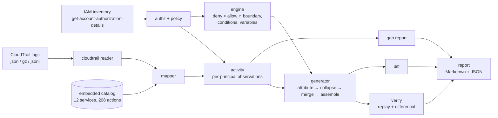

# leastpriv

Least-privilege IAM policy generator and right-sizer for defenders. leastpriv
reads IAM policies and CloudTrail activity (JSON, offline), maps every
observed API call to the IAM action and resource ARN it needed, generates the
smallest policy that still allows that activity, **proves** the new policy is
never broader than the original, and reports which granted permissions were
never used and how long ago used ones were last exercised.

```
original grant  ──►  observed ⊆ generated ⊆ original  ──►  verified, diffed, reported
```

- **Generate** minimal identity policies with action and resource scoping and
  wildcard collapsing at three aggressiveness levels (`exact`, `moderate`,
  `aggressive`).
- **Evaluate** policies with an engine that mirrors AWS's documented logic:
  explicit deny > allow, permissions boundaries, `NotAction`/`NotResource`,
  wildcards, policy variables and the documented Condition operator subset,
  with three-valued logic for context CloudTrail does not record.
- **Verify** every generated policy twice: replay of every observed call
  (superset) and a differential check over hundreds of thousands of probe
  requests (subset of the original).
- **Report** permission gaps (granted vs used, last-used age, stale/unused/
  unobservable, risk), before/after effective diffs and unified JSON diffs,
  in Markdown for people and JSON for pipelines.

Pure Go, standard library only, no network access, no AWS credentials.

## Who it is for

Cloud security and platform engineers cleaning up over-broad roles (the CI
role with `"Action": "*"`, the service with `s3:*` on a bucket), reviewers of
IAM changes who want an effective diff rather than a JSON diff, and auditors
who need a granted-vs-used report. It is a local, explainable alternative to
"generate policy from CloudTrail" features, with the subset guarantee made
explicit and checked.

## Architecture



How generation stays inside the original grant: each observed call is
attributed to the original Allow statement that granted it; generated
statements inherit that statement's `Condition` verbatim and must pass a
sound pattern-subsumption proof against its `Action`/`Resource`; original
`Deny` statements and the permissions boundary are kept as they are. The
details, algorithms and a complexity table are in
[docs/ARCHITECTURE.md](docs/ARCHITECTURE.md); the threat model is in
[docs/THREAT_MODEL.md](docs/THREAT_MODEL.md).

## Quickstart

Requirements: Go ≥ 1.24 (developed with 1.27), `make`; `golangci-lint` v2 for
`make check`.

```sh
make build                      # ./bin/leastpriv, ./bin/lp-synth, ./bin/lp-eval
make demo                       # offline end-to-end run on the bundled synthetic account
make check                      # gofmt + golangci-lint + build/vet + tests + coverage gate
```

With your own data (exported by you, analysed locally):

```sh
aws iam get-account-authorization-details > authz.json
# CloudTrail: the S3-delivered *.json.gz files (a directory is fine), or JSON Lines

leastpriv gap      --authz authz.json --trail ./cloudtrail --stale-days 30
leastpriv generate --authz authz.json --trail ./cloudtrail --level moderate --out ./out
leastpriv diff     out/original/role-ci-deployer.1.json out/role-ci-deployer.policy.json
leastpriv verify   --authz authz.json --trail ./cloudtrail --principal ARN --policy out/role-x.policy.json
leastpriv simulate --authz authz.json --principal ARN --action s3:GetObject --resource arn:aws:s3:::b/k
leastpriv validate policy.json
leastpriv catalog  's3:*Object*'
leastpriv map      --trail ./cloudtrail --limit 20
```

Useful flags: `--principal` (repeatable), `--from/--to` (observation window),
`--level exact|moderate|aggressive`, `--min-siblings`, `--min-actions`,
`--max-size` (split documents above this many characters; default 6144),
`--format md|json`. Exit codes: 0 ok, 1 error, 2 usage, 3 verification
failed, 4 invalid policy.

## Demo

`make demo` runs [scripts/demo.sh](scripts/demo.sh) against `testdata/acme`,
a deterministic synthetic account (fictional account `111122223333`, 90 days,
9,561 CloudTrail records, 5 principals). Output from a real run, trimmed where
marked:

```text
==> 2. Permission-gap report for the CI role (granted vs used, last-used age)
$ leastpriv gap --authz testdata/acme/authz.json --trail testdata/acme/cloudtrail --principal arn:aws:iam::111122223333:role/ci-deployer --out out/demo/gap
# Permission gap report

| Principal | Granted | Used | Stale | Unused | Unobservable | Unused % | High-risk unused |
|---|---:|---:|---:|---:|---:|---:|---:|
| `arn:aws:iam::111122223333:role/ci-deployer` | 207 | 8 | 0 | 197 | 2 | 95.2 | 95 |

==> 3. Generate, verify and diff minimal policies for every principal (moderate)
$ leastpriv generate --authz testdata/acme/authz.json --trail testdata/acme/cloudtrail --level moderate --out out/demo/policies
# Least-privilege policy report

Level: `moderate`. Input: 9561 CloudTrail records, 9870 observations, 14 access-denied attempts, 30 records from non-principal callers, window 2026-07-01 to 2026-09-28.

Events from services outside the catalog (ignored): cloudformation.amazonaws.com x45.

| Principal | Distinct calls | Granted | Statements | Size (chars) | Replay | Subset check |
|---|---:|---:|---:|---:|---|---|
| `arn:aws:iam::111122223333:role/app/app-backend` | 2218 | 2218 | 12 | 1969 | 6931/6931 allowed | 0 violations in 672768 requests |
| `arn:aws:iam::111122223333:role/ci-deployer` | 270 | 270 | 4 | 1443 | 726/726 allowed | 0 violations in 312000 requests |
| `arn:aws:iam::111122223333:role/legacy-reporting` | 0 | 0 | 0 | 0 | n/a | n/a |
| `arn:aws:iam::111122223333:role/ops-automation` | 16 | 16 | 4 | 743 | 1330/1330 allowed | 0 violations in 26180 requests |
| `arn:aws:iam::111122223333:user/analyst-01` | 17 | 17 | 5 | 813 | 805/805 allowed | 0 violations in 22428 requests |

==> 5. Before/after diff for the CI role (effective, per action)
$ leastpriv diff out/demo/policies/original/role-ci-deployer.1.json out/demo/policies/role-ci-deployer.policy.json
# Policy diff

Statements 2 -> 4; size 316 -> 1443 characters.

| Removed | Narrowed | Widened | Added | Changed | Unchanged |
|---:|---:|---:|---:|---:|---:|
| 200 | 8 | 0 | 0 | 0 | 0 |

==> 6. A sensitive decoy object: allowed by the original grant, denied by the generated one
$ leastpriv simulate --authz testdata/acme/authz.json --principal arn:aws:iam::111122223333:role/app/app-backend --action s3:GetObject --resource arn:aws:s3:::acme-app-data/admin/break-glass.txt
allowed: s3:GetObject on arn:aws:s3:::acme-app-data/admin/break-glass.txt (an Allow statement applies and no Deny applies)
  matched AppBackendAccess statement 0 S3Data [Allow]
$ leastpriv simulate --policy out/demo/policies/role-app-backend.policy.json --action s3:GetObject --resource arn:aws:s3:::acme-app-data/admin/break-glass.txt
implicitDeny: s3:GetObject on arn:aws:s3:::acme-app-data/admin/break-glass.txt (no statement allows the request (implicit deny))

==> 7. Independent re-verification of a generated policy
$ leastpriv verify --authz testdata/acme/authz.json --trail testdata/acme/cloudtrail --principal arn:aws:iam::111122223333:role/app/app-backend --policy out/demo/policies/role-app-backend.policy.json
PASS arn:aws:iam::111122223333:role/app/app-backend: replay 6931/6931 allowed (0 uncertain); differential 672768 requests, 8688 allowed by generated, 0 violations
```

The CI role's original policy was `"Action": "*"` in two regions; the
generated one keeps the region condition and grants 8 Lambda/S3 actions on
the three deploy functions and `acme-artifacts/builds/*`. Steps 1 (mapping),
4 (the generated JSON) and 8 (evaluation) are in the full output.

## Evaluation

Everything below is on **synthetic data** generated by `lp-synth`; see
[DATA.md](DATA.md). The scenario has ground truth: what each workload truly
needs (including monthly jobs) and decoy requests it must never be allowed.
Policies are generated from the first 60 days only and scored on the
held-out last 30 days, so a rare need missing from training shows up as
breakage instead of being hidden.

Command: `make eval` (`./bin/lp-eval --data testdata/acme --out out/eval`)

| Principal | Level | Stmts | Size | Held-out allow rate | Broken pairs | Excess actions (orig -> gen) | Decoys allowed (orig -> gen) | Needed actions granted |
|---|---|---:|---:|---:|---:|---|---|---|
| role/app/app-backend | exact | 12 | 93191 | 68.5% (1587/2317) | 730 | 63 -> 0 | 8 -> 0 of 8 | 15/16 |
| role/app/app-backend | moderate | 12 | 2017 | 73.9% (1711/2317) | 606 | 63 -> 0 | 8 -> 0 of 8 | 15/16 |
| role/app/app-backend | aggressive | 12 | 1682 | 100.0% (2316/2317) | 1 | 63 -> 0 | 8 -> 0 of 8 | 15/16 |
| role/ci-deployer | exact | 5 | 11124 | 65.3% (158/242) | 84 | 198 -> 0 | 6 -> 0 of 6 | 7/8 |
| role/ci-deployer | moderate | 4 | 1417 | 99.6% (241/242) | 1 | 198 -> 0 | 6 -> 0 of 6 | 7/8 |
| role/ci-deployer | aggressive | 4 | 1037 | 99.6% (241/242) | 1 | 198 -> 0 | 6 -> 0 of 6 | 7/8 |
| user/analyst-01 | exact | 5 | 1223 | 55.2% (144/261) | 4 | 19 -> 0 | 3 -> 0 of 4 | 6/6 |
| user/analyst-01 | moderate | 5 | 869 | 55.2% (144/261) | 4 | 19 -> 0 | 3 -> 0 of 4 | 6/6 |
| user/analyst-01 | aggressive | 5 | 813 | 100.0% (261/261) | 0 | 19 -> 0 | 3 -> 0 of 4 | 6/6 |
| role/ops-automation | exact | 4 | 888 | 100.0% (441/441) | 0 | 18 -> 0 | 3 -> 0 of 4 | 8/8 |
| role/ops-automation | moderate | 4 | 743 | 100.0% (441/441) | 0 | 18 -> 0 | 3 -> 0 of 4 | 8/8 |
| role/ops-automation | aggressive | 4 | 687 | 100.0% (441/441) | 0 | 18 -> 5 | 3 -> 0 of 4 | 8/8 |
| role/legacy-reporting | exact | 0 | 0 | 100.0% (0/0) | 0 | 4 -> 0 | 2 -> 0 of 2 | 0/0 |
| role/legacy-reporting | moderate | 0 | 0 | 100.0% (0/0) | 0 | 4 -> 0 | 2 -> 0 of 2 | 0/0 |
| role/legacy-reporting | aggressive | 0 | 0 | 100.0% (0/0) | 0 | 4 -> 0 | 2 -> 0 of 2 | 0/0 |

Gap report on the training window vs. ground truth ("unused" should equal
"granted but not needed"):

| Principal | Reported unused | Truly unneeded grants | Precision | Recall | False positives |
|---|---:|---:|---:|---:|---|
| role/app/app-backend | 64 | 63 | 0.984 | 1.000 | secretsmanager:DescribeSecret |
| role/ci-deployer | 198 | 198 | 0.995 | 0.995 | lambda:DeleteFunction |
| user/analyst-01 | 19 | 19 | 1.000 | 1.000 | - |
| role/ops-automation | 18 | 18 | 1.000 | 1.000 | - |
| role/legacy-reporting | 4 | 4 | 1.000 | 1.000 | - |

How to read it:

- **Every level removes every excess action and denies every decoy the
  original allowed** — except `aggressive` on ops-automation, whose
  `ec2:Describe*` fold re-grants 5 unneeded read-only actions (reported as an
  expansion).
- **The trade-off is breakage on new resources.** `exact` lists object keys
  verbatim, so the next month's new keys fail (65–69% allow rate for the S3-
  heavy roles). `moderate` only rolls up folders that look uniform; for
  app-backend it stops at month folders, so September objects still break
  (73.9%). `aggressive` generalises to `uploads/2026/*` and survives the
  held-out month at ~100%. Choosing the level is a policy decision, which is
  why it is a flag.
- **The misses are rare needs.** The single "needed action not granted" for
  app-backend and ci-deployer, and the gap-report false positives
  (`secretsmanager:DescribeSecret`, `lambda:DeleteFunction`), are quarterly
  operations that never happened in the 60-day training window. No
  log-based tool can see them; the gap report's `stale`/`unused` split and a
  long enough window are the mitigation.

## Tests and quality gates

| What | Command | Result (this commit) |
|---|---|---|
| Full gate: gofmt, golangci-lint (0 issues), build + vet, tests, coverage ≥ 80% | `make check` | pass |
| Coverage of `internal/...` (cross-package) | `./scripts/coverage.sh` | 95.8% |
| Evaluator table tests mirroring the IAM User Guide (each case names its section) | `go test -run TestEvaluationLogic -v ./internal/engine` | 67 cases |
| Property test `observed ⊆ generated ⊆ original`, random policies (wildcards, NotAction/NotResource, conditions, variables, 2008 version, denies, boundaries) × 3 levels | `go test -run TestPropertyObserved ./internal/generator` | 400 iterations per level (`-short`: 60; `LP_PROPERTY_ITER` / `LP_PROPERTY_SEED` override) |
| Glob matcher vs a regexp oracle, subsumption soundness, fuzz target | `go test ./internal/glob` (`go test -fuzz FuzzMatch ./internal/glob` to fuzz) | pass |
| Golden reports and policies (`testdata/golden/`) | `go test -run Golden ./internal/generator ./internal/report` | pass |
| Fixtures reproduce byte-for-byte | `make fixtures && git diff --exit-code testdata/` | no diff |

All tests are offline; none needs Docker or network. `make integration` is a
documented no-op for that reason.

## Benchmarks

Command: `make bench`. One run on an Apple M1 Pro (8 cores used by Go,
machine shared with other builds, so treat as indicative):

| Benchmark | Result |
|---|---|
| `glob.Match` (typical ARN pattern) | 213 ns/op |
| `glob.Subsumes` | 2.1 µs/op |
| `engine` evaluate one request | 551 ns/op, 3 allocs |
| Generate, 1k observations (exact / moderate / aggressive) | 1.2 / 2.5 / 1.8 ms |
| Generate, 10k observations | 9.3 / 18.1 / 14.6 ms |
| Generate, 100k observations | 86 / 154 / 149 ms |

Generation grows roughly linearly in the number of observations, as the
complexity analysis predicts (attribution O(E·S), collapsing O(N·L)).

Size: `find cmd internal -name '*.go' ! -name '*_test.go' | xargs cat | wc -l`
→ 8,371 lines of non-test Go; the same with `-name '*_test.go'` → 3,470 lines
of tests.

## Design decisions

The full log with costs is in [DECISIONS.md](DECISIONS.md). The ones that
shape the tool:

1. **Provable subset, not best-effort.** Grants are attributed to a source
   statement, inherit its conditions, and are emitted only if sound
   subsumption proves them inside it. The differential check is a second line
   of defence, not the proof.
2. **Unknown is a value.** Conditions on keys CloudTrail does not record
   evaluate to "maybe"; reports count uncertain replays instead of guessing.
3. **Never widen to `*`.** Partially resolved resources are scoped to their
   resource type; flat namespaces are never collapsed to a bare `*`.
4. **A dial, with evidence.** Three levels, and an evaluation on held-out
   data that shows what each one costs.
5. **Offline and dependency-free.** Embedded catalog, stdlib only, no AWS
   calls.

## Limitations

- **Synthetic evaluation only.** All numbers above come from one scenario the
  author designed. They show the mechanics and the trade-offs, not accuracy
  on real accounts. No real CloudTrail has been run through the tool.
- **Catalog subset.** 12 services and 208 actions, curated by hand. Calls to
  other services are counted and ignored (no policy is generated for them),
  and the catalog will drift as AWS adds actions and events.
- **Identity policies and boundaries only.** Resource-based policies, SCPs and
  RCPs, session policies and cross-account access are not modelled. A call
  allowed only by a bucket policy appears as "used but not granted".
- **Documented semantics only.** The engine follows the IAM User Guide;
  undocumented behaviour (some type coercions, service-specific quirks,
  `BinaryEquals`) is not reproduced, and unknown operators are rejected.
- **CloudTrail blind spots.** Data events must be enabled to see S3 object or
  DynamoDB item calls; some actions are not logged at all; many condition
  keys (tags, `aws:CalledVia`, service keys) are not in the logs. leastpriv
  flags these instead of hiding them, but it cannot see what was not logged.
- **Activity-based right-sizing cannot predict rare needs.** Anything the
  workload did not do in the window is removed. Use a window that covers
  monthly and quarterly jobs and review the `stale`/`unused` lists.
- **The differential check samples** above 250,000 (action, resource) pairs
  per context; it is evidence, not proof, for very large inventories.
- **Poisoning keeps privilege.** A principal that exercises a permission keeps
  it; generation can never add privilege beyond the original grant, but it
  cannot tell legitimate from malicious use.
- **CI is configured but has not run**: `.github/workflows/ci.yml` runs the
  same gates, but the repository has not been pushed, so it has never
  executed on GitHub.

## Roadmap

- Resource-based policy and SCP evaluation, so "used but not granted" calls
  can be attributed.
- Generating the catalog from the machine-readable Service Authorization
  Reference instead of a hand-curated table.
- Organisation-trail input with per-account fan-out and streaming over S3
  exports larger than memory.
- Tag-aware resource scoping (`aws:ResourceTag`) when tag snapshots are
  supplied alongside CloudTrail.
- SARIF output for code-review integration.

## License

MIT — see [LICENSE](LICENSE).
